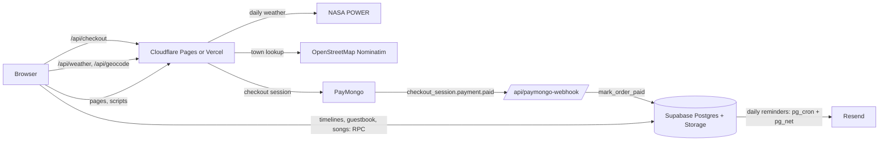

# Homeday

**Every day since they came home.** Homeday turns the day a pet came home into a shareable timeline: the weather and the moon that day, the song at number one, every milestone since, and a guestbook for friends. Timelines are free; printable keepsakes are paid in pesos through PayMongo.

[](https://github.com/Ahyan3/homeday/actions/workflows/ci.yml)

Live: [homeday-eight.vercel.app](https://homeday-eight.vercel.app) · Moving to Cloudflare Pages (see [deployment](docs/deployment.md))

## Features

- **Timeline from one date.** Milestones (first week, 100 days, 1,000 days, every homeday), age in human years, and what's coming next.
- **The day they came home.** Moon phase (computed), weather from NASA POWER, and that week's Billboard Hot 100 number one, from 1958 onward.
- **Save and share.** Each timeline gets a short link and a private edit link. No accounts.
- **Photos and guestbook.** Up to 12 photos, resized in the browser before upload. Friends can leave messages; the owner can hide them.
- **Memorial mode.** A quieter timeline that ends on the day you said goodbye, with no upsell.
- **Keepsakes.** A printable poster and certificate, unlocked after payment. Prints and books are built but switched off at launch.
- **Homeday reminders.** Owners can ask for one email a year, a week before each homeday, with a link back to the timeline and the keepsake. Never for memorials. Sent from the database, so it works on any host.
- **Pay by QR code.** Before PayMongo is live, buyers pay your GCash, Maya or GoTyme QR code and send the reference number; you confirm it on `/admin` and the keepsake unlocks. Switches to PayMongo by itself once its key is set.
- **Works for visitors abroad.** Visitors outside the Philippines see prices in US dollars and can switch; US visitors also get Fahrenheit and US-style dates. Dollar charging switches on with one setting once PayMongo enables it.
- **Help and policies.** Help, terms, privacy (Philippine Data Privacy Act), refunds and security pages, plus `security.txt`.
- **Security.** Strict content security policy and security headers on both hosts, fonts served from the site, no third-party scripts.
- **Share previews.** On Cloudflare, shared links show the pet's name, and timelines are kept out of search engines.

## How it works



- The browser talks to Supabase only through a handful of `SECURITY DEFINER` functions. The tables themselves are closed to the public. See [database](docs/database.md).
- Server code lives once in `lib/` and uses only web-standard APIs, so the same files run on Cloudflare Pages Functions and Vercel Functions.
- Payments are verified twice: the webhook checks PayMongo's HMAC signature, and the database refuses to mark an order paid if the amount is below the price recorded when checkout opened.

## Project structure

```
public/               Website: pages, styles, browser scripts, share image
  assets/core.js      Dates, moon, timeline drawing, database calls
  assets/app.js       Page logic: form, saving, sharing, guestbook, checkout
  assets/remind.js    Reminder sign-up for timeline owners
  assets/prices.js    Prices in the visitor's currency, and the currency switch
  assets/manual.js    Payment by QR code (GCash, Maya, GoTyme)
  admin.html          Owner page for confirming QR code payments
  assets/fonts/       Self-hosted fonts (SIL Open Font License)
  help, terms, privacy, refunds, security .html   Help and policy pages
  unsubscribe.html    Stops reminder emails
lib/                  Server code shared by both hosts
  checkout.js         Creates PayMongo checkout sessions
  webhook.js          Verifies and records payments
  weather.js          NASA POWER proxy with long-lived caching
  geocode.js          OpenStreetMap lookup with caching
  preview.js          Share previews (Cloudflare only)
functions/            Cloudflare routes, three lines each, pointing into lib/
api/                  Vercel routes, the same for Vercel
supabase/migrations/  Database schema and functions, in order
supabase/seed/        Loads the Billboard number ones
tests/                Server tests (node:test, no dependencies)
docs/                 Deployment, database and day-to-day operations
```

## Running it locally

Needs Node 22.

```bash
npm test          # server tests, no network needed
npm run check     # syntax check of every script
npm run dev       # site + functions on http://localhost:8788 (Cloudflare's local runner)
```

For checkout to work locally, copy `.dev.vars.example` to `.dev.vars` and fill in test keys. Without them, the Buy buttons say payments aren't switched on, and everything else works.

## Configuration

| Variable | Required | What it's for |
| --- | --- | --- |
| `HOMEDAY_DB_SECRET` | For payments | Lets the server create and mark orders in the database |
| `PAYMONGO_SECRET_KEY` | For payments | `sk_test_…` while testing, `sk_live_…` at launch |
| `PAYMONGO_WEBHOOK_SECRET` | For payments | Verifies that payment notices really come from PayMongo |
| `PRINTS_ENABLED` | No | `1` to sell prints and books (also un-hide their rows in `public/index.html`) |
| `PAYMONGO_METHODS` | No | Comma-separated payment methods, if you want to override what your account allows |
| `SITE_URL` | No | Your own domain, used for PayMongo's return links |
| `USD_CHARGING` | No | `1` to charge overseas card buyers US$12 instead of ₱699. Only after PayMongo turns on USD card acceptance for your account |

Reminder email settings (`resend_api_key`, `reminder_from`, `site_url`) live in the database's `app_secrets` table, not on the host. See [operations](docs/operations.md#switch-on-reminder-emails).

Charged prices live in `lib/shared.js` (`PRICES` in centavos, `USD_PRICES` in US cents). Shown prices live in `H.PRICES` in `public/assets/core.js`. Keep them the same.

## Documentation

- [Deployment](docs/deployment.md): move to Cloudflare Pages, connect PayMongo, go live
- [Database](docs/database.md): tables, functions, and the security model
- [Operations](docs/operations.md): orders, refunds, deleting a timeline, turning on prints

## Credits

Weather: [NASA POWER](https://power.larc.nasa.gov/). Places: © [OpenStreetMap contributors](https://www.openstreetmap.org/copyright). Song history: Billboard Hot 100 via [utdata/rwd-billboard-data](https://github.com/utdata/rwd-billboard-data). Fonts: Bricolage Grotesque and Newsreader (Google Fonts).

## License

Copyright © 2026 Ryan Francis Romano. All rights reserved. See [LICENSE](LICENSE).
